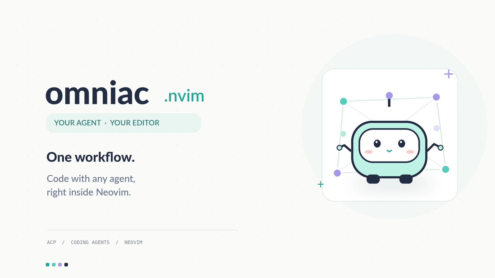
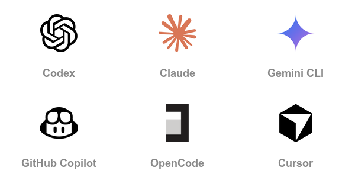
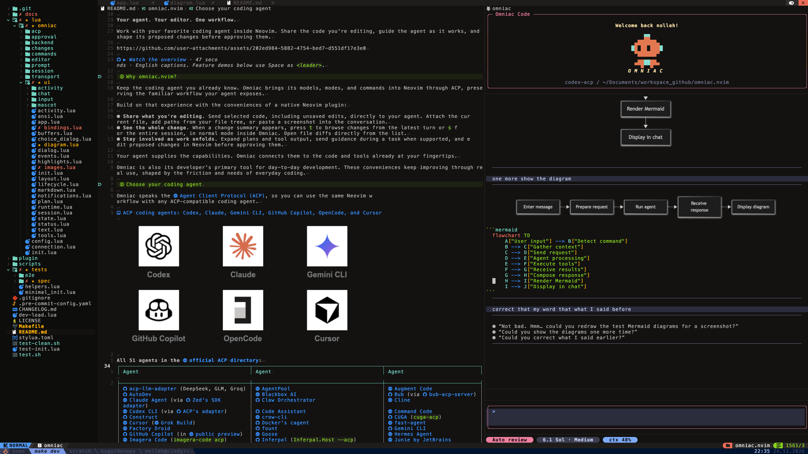
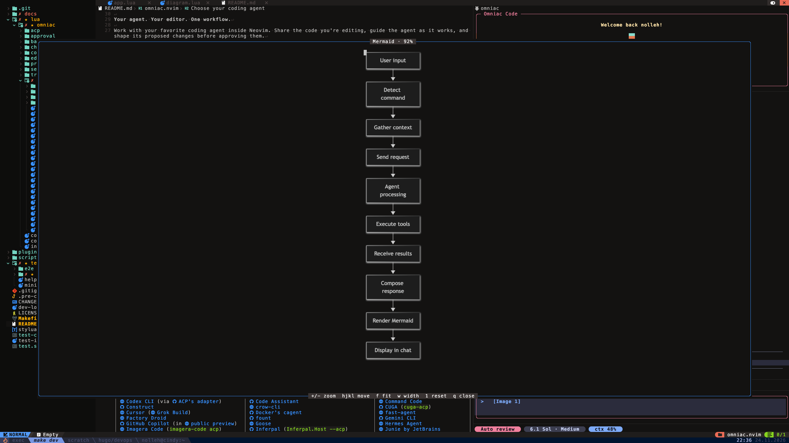

# omniac.nvim



**Your agent. Your editor. One workflow.**

Work with your favorite coding agent inside Neovim. Share the code you're editing, guide the agent as it works, and shape its proposed changes before approving them.

https://github.com/user-attachments/assets/202ed984-5882-4754-bed7-d551df17e3e0

*[▶ Watch the overview](https://github.com/user-attachments/assets/202ed984-5882-4754-bed7-d551df17e3e0) · 47 seconds · English captions. Feature demos below use Space as `<leader>`.*

## Why omniac.nvim?

Keep the coding agent you already know. Omniac brings its models, modes, and commands into Neovim through ACP, preserving the familiar workflow your agent exposes.

Build on that experience with the conveniences of a native Neovim plugin:

- **Share what you're editing.** Send selected code, including unsaved edits, directly to your agent. Attach the current file, add paths from your file tree, or paste a screenshot into the conversation.
- **See the whole change.** When a change summary appears, press `t` to browse changes from the latest turn or `s` for the entire session, in normal mode inside Omniac. Open file diffs directly from the list.
- **Stay involved as work unfolds.** Expand plans and tool output, send guidance during a task when supported, and edit proposed changes in Neovim before approving them.

Your agent supplies the capabilities. Omniac connects them to the code and tools already at your fingertips.

Omniac is also its developer's primary tool for day-to-day development. These conveniences keep improving through real use, shaped by the friction and needs of everyday coding.

## Choose your coding agent

Omniac speaks the [Agent Client Protocol (ACP)](https://agentclientprotocol.com), so you can use the same Neovim workflow with any ACP-compatible coding agent.



**All 51 agents in the [official ACP directory](https://agentclientprotocol.com/get-started/agents):**

| Agent | Agent | Agent |
| --- | --- | --- |
| [acp-llm-adapter](https://github.com/euri10/acp-llm-adapter) (DeepSeek, GLM, Groq) | [AgentPool](https://phil65.github.io/agentpool/advanced/acp-integration/) | [Augment Code](https://docs.augmentcode.com/cli/acp) |
| [AutoDev](https://github.com/phodal/auto-dev) | [Blackbox AI](https://docs.blackbox.ai/features/blackbox-cli/introduction) | [Bub](https://github.com/bubbuild/bub) (via [bub-acp-server](https://github.com/bubbuild/bub-contrib/tree/main/packages/bub-acp-server)) |
| [Claude Agent](https://platform.claude.com/docs/en/agent-sdk/overview) (via [Zed's SDK adapter](https://github.com/zed-industries/claude-agent-acp)) | [Claw Orchestrator](https://github.com/Enderfga/claw-orchestrator/blob/main/skills/references/acp.md) | [Cline](https://cline.bot/) |
| [Codex CLI](https://developers.openai.com/codex/cli) (via [ACP's adapter](https://github.com/agentclientprotocol/codex-acp)) | [Code Assistant](https://github.com/stippi/code-assistant?tab=readme-ov-file#configuration) | [Command Code](https://commandcode.ai/docs/acp) |
| [Construct](https://github.com/construct-worlds/construct#acp-agent-client-protocol-server) | [crow-cli](https://crow-ai.dev) | [CUGA](https://github.com/cuga-project/cuga-agent/tree/main/docs/examples/acp_stdio) (`cuga-acp`) |
| [Cursor](https://cursor.com/docs/cli/acp) ([Grok Build](https://grok.com/build)) | [Docker's cagent](https://github.com/docker/cagent) | [fast-agent](https://fast-agent.ai/acp) |
| [Factory Droid](https://factory.ai/) | [fount](https://github.com/steve02081504/fount) | [Gemini CLI](https://github.com/google-gemini/gemini-cli) |
| [GitHub Copilot](https://github.com/features/copilot) (in [public preview](https://github.blog/changelog/2026-01-28-acp-support-in-copilot-cli-is-now-in-public-preview/)) | [Goose](https://block.github.io/goose/docs/guides/acp-clients) | [Hermes Agent](https://hermes-agent.nousresearch.com/docs/user-guide/features/acp) |
| [Imagera Code](https://imagera.ai/code) (`imagera-code acp`) | [Inferpal](https://github.com/EstaxNet/Inferpal/blob/master/docs/acp.md) (`Inferpal.Host --acp`) | [Junie by JetBrains](https://junie.jetbrains.com) |
| [Kaagum](https://git.systemreboot.net/kaagum/about/) | [Kimi CLI](https://github.com/MoonshotAI/kimi-cli) | [Kiro CLI](https://kiro.dev/docs/cli/acp/) |
| [localharness](https://github.com/compusophy/localharness#quickstart) | [Mercury CLI](https://github.com/Whq02/MercuryCLI/blob/main/docs/AUTOMATION.md) (`mercury acp`) | [Minion Code](https://github.com/femto/minion-code) |
| [Mistral Vibe](https://github.com/mistralai/mistral-vibe) | [Muse Spark Code](https://github.com/RandyNorthrup/muse-spark-code/blob/main/docs/acp.md) (unofficial agent for Meta's Muse Spark) | [Octomind](https://github.com/muvon/octomind/blob/master/doc/integration/02-acp-protocol.md) (`octomind acp`) |
| [OpenClaw](https://docs.openclaw.ai/cli/acp) | [OpenCode](https://github.com/sst/opencode) | [OpenHands](https://docs.openhands.dev/openhands/usage/run-openhands/acp) |
| [Pi](https://github.com/badlogic/pi-mono/tree/main/packages/coding-agent) (via [pi-acp adapter](https://github.com/svkozak/pi-acp)) | [Poolside](https://github.com/poolsideai/pool) | [Qoder CLI](https://docs.qoder.com/cli/acp) |
| [Qwen Code](https://github.com/QwenLM/qwen-code) | [Raven](https://evermind-ai.github.io/Raven/agent-protocols/) (`raven acp`) | [Raxol](https://github.com/DROOdotFOO/raxol/blob/master/docs/features/CODING_AGENT.md) (`raxol acp`) |
| [siGit Code](https://github.com/getsigit/sigit) | [Stakpak](https://github.com/stakpak/agent?tab=readme-ov-file#agent-client-protocol-acp) | [stdio Bus](https://github.com/stdiobus/stdiobus) |
| [VT Code](https://github.com/vinhnx/vtcode/blob/main/README.md#zed-ide-integration-agent-client-protocol) | [ZenCODE](https://github.com/gerardogrisolini/ZenCODE/blob/main/Docs/xcode.md) (`zen --acp`) | [zycode](https://zycode.dev) (`pi-agent-cli-lc`) |

Available models, modes, and capabilities come from the agent you choose.

Install and authenticate an ACP agent or adapter, then set [`agent.cmd`](https://github.com/nolleh/omniac.nvim/wiki/Getting-Started#install-an-agent) to its executable. Codex is the default: `npm install -g @agentclientprotocol/codex-acp`.

## Features

### Guide work in progress

A new thought doesn't have to wait until the task is over.

Press `Enter` to send a message into the running task when your agent supports it, or `Tab` to queue the next request. Code and image attachments stay with your message.

https://github.com/user-attachments/assets/c2cbcb67-4e0a-4b47-b71d-a323031dff9d

*[▶ Watch the short demo](https://github.com/user-attachments/assets/c2cbcb67-4e0a-4b47-b71d-a323031dff9d) · `Enter` sends now · `Tab` queues the next request.*

### Shape proposed changes

Review proposed edits in native Neovim diffs. Accept, reject, or make a small adjustment directly in the review buffer.

Omniac carries your adjusted proposal into a follow-up so the agent can apply the version you reviewed.

https://github.com/user-attachments/assets/539a7a13-ffcc-469f-9508-44a2ee49b972

*[▶ Watch the short demo](https://github.com/user-attachments/assets/539a7a13-ffcc-469f-9508-44a2ee49b972) · Edit the proposal with normal Vim commands, then press `<leader>aa` to approve.*

### Follow the work

See the current step at a glance. Expand the full plan with `Ctrl-P` when you want the details, and unfold command output with `Ctrl-T`.

When the task finishes, browse what changed in the latest turn or across the session.

https://github.com/user-attachments/assets/0b03a173-727c-4891-849a-b409f606031f

*[▶ Watch the short demo](https://github.com/user-attachments/assets/0b03a173-727c-4891-849a-b409f606031f) · `Ctrl-P` expands the plan · `Ctrl-T` expands output · `/changes session` opens the changed-file list.*

### Bring your context

Select code and send it straight to the conversation. Add a file from your editor or file tree, or paste a screenshot into the input.

Selected code includes your unsaved edits, so you can discuss what you're working on right now.

https://github.com/user-attachments/assets/12a8034b-102e-467c-aacb-73f3b8172f02

*[▶ Watch the short demo](https://github.com/user-attachments/assets/12a8034b-102e-467c-aacb-73f3b8172f02) · Select code and press `<leader>as` · `<leader>ab` attaches the current file · `<leader>af` focuses the input.*

### Explore diagrams without leaving Neovim

Read Mermaid diagrams directly in the conversation, then open a larger view when you want a closer look.



Place the cursor inside a Mermaid block in normal-mode chat and press `Enter` to open the viewer. Use `+` / `-` to zoom, `h j k l` to move around, and `q` to return to the conversation. Press `f` to fit the whole diagram or `w` to fit its width.



Diagram rendering uses optional [Snacks image support and the Mermaid CLI](https://github.com/nolleh/omniac.nvim/wiki/Getting-Started#optional-mermaid-rendering).

### Pick up where you left off

Browse saved sessions and restore the conversation. Switch between your agent's available models and modes as the task changes.

### A little company while you code

A little companion on the welcome card follows your cursor, hops around, and reacts when you pet it. Give it too much attention and it might run away.

https://github.com/user-attachments/assets/3eda6537-79d1-488f-a9ed-934f5592690c

*[▶ Watch the short demo](https://github.com/user-attachments/assets/3eda6537-79d1-488f-a9ed-934f5592690c) · Move to the welcome card with `Ctrl-K`, then move the cursor across the companion with `h` / `l`.*

## Installation

Omniac needs an **ACP-compatible executable**. If your agent's CLI does not support ACP directly, install its ACP adapter first. For Codex, install and authenticate the `codex-acp` adapter:

```sh
npm install -g @agentclientprotocol/codex-acp
codex-acp login
```

Omniac uses `codex-acp` as its default agent command, so you don't need to configure `agent.cmd` separately.

Install Omniac with [lazy.nvim](https://github.com/folke/lazy.nvim):

```lua
{
  "nolleh/omniac.nvim",
  dependencies = {
    "nvim-treesitter/nvim-treesitter",
    "MeanderingProgrammer/render-markdown.nvim",
  },
  opts = {},
}
```

See [Getting started](https://github.com/nolleh/omniac.nvim/wiki/Getting-Started) for parser setup and agent configuration.

## Quick start

| Action | Key or command |
| --- | --- |
| Open Omniac | `<leader>ac` |
| Focus the input | `<leader>af` |
| Attach selected code | `<leader>as` in visual mode |
| Attach the current file | `<leader>ab` |
| Attach a clipboard image | `Ctrl-V` in input |
| Choose a session | `/resume` |
| Choose a model | `<leader>am` · `/model` |
| Choose a mode | `<leader>aM` · `/mode` |
| Review changes | `/changes` |

Default keymaps are registered automatically and preserve existing mappings. To disable all defaults, set `opts = { keymaps = false }` in your lazy.nvim spec. Customize or disable individual mappings with:

```lua
opts = {
  keymaps = {
    open = "<leader>ao", -- Change the toggle key
    reference = false, -- Disable the visual-selection mapping
  },
}
```

The default Codex mode is read-only. Use `/mode` to choose an editing mode.

## Documentation

[Getting started](https://github.com/nolleh/omniac.nvim/wiki/Getting-Started) · [Configuration](https://github.com/nolleh/omniac.nvim/wiki/Configuration) · [Commands and keymaps](https://github.com/nolleh/omniac.nvim/wiki/Commands-and-Keymaps)

[All guides](https://github.com/nolleh/omniac.nvim/wiki/Home) · [Changelog](CHANGELOG.md)

## License

[MIT](LICENSE) © 2026 nolleh. Agent logo assets retain their [upstream notices](docs/assets/agents/README.md).
